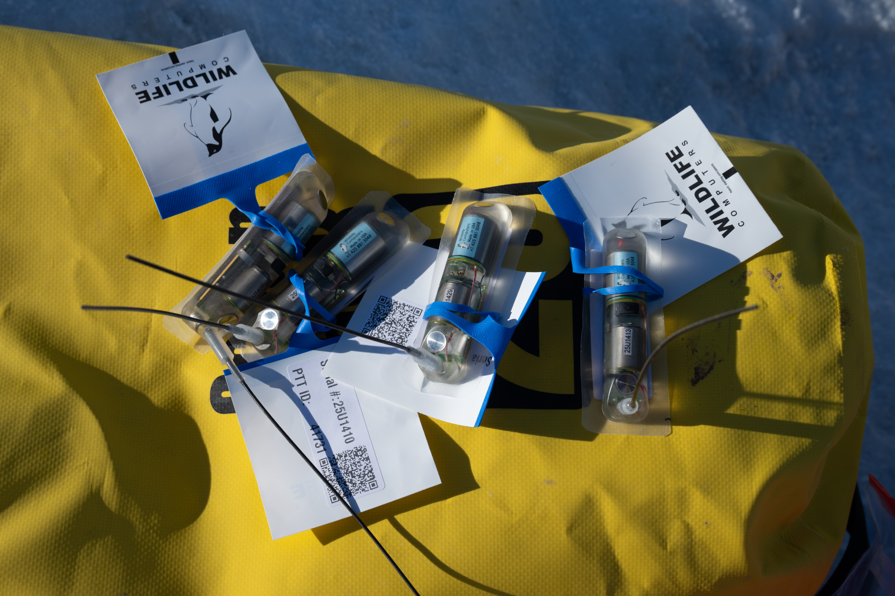

::::::: {.partner-opening}
:::::: {.partner-opening-image}
{fig-alt="Adélie penguins on the ice with Malizia Explorer anchored nearby."}
::::::
:::::: {.partner-intro}
[SCIENCE · SAILING · SHARED PURPOSE]{.partner-eyebrow}

# Help us understand and protect Antarctic wildlife.

Partnerships help make our research possible—from reaching remote Antarctic habitats to sharing what we discover.

We welcome conversations with individuals, foundations, companies, and organisations who would like to contribute. Support can take many forms: funding, equipment, practical expertise, or helping our findings reach new audiences.

[Start a conversation](contact.qmd){.btn .partner-button}
::::::
:::::::

::::::: {.partner-ways}
## Different ways to make a difference

There is no single way to become involved. Together, we can explore where your interests and our research needs meet.

:::::: {.partner-support-grid}
::::: {.partner-support-item}
### Expeditions & fieldwork

Help make research voyages possible through support for transport, expedition logistics, and the time needed to work in remote Antarctic habitats.
:::::
::::: {.partner-support-item}
### Scientific equipment & research

Contribute towards tracking devices, field instruments, laboratory analyses, or tools that help us understand wildlife and its habitats.
:::::
::::: {.partner-support-item}
### Knowledge & practical expertise

Bring skills, services, or technical support—from equipment development and field logistics to data analysis and interpretation.
:::::
::::: {.partner-support-item}
### Education & communication

Help bring Antarctic research into classrooms and share its discoveries through photography, films, exhibitions, and public engagement.
:::::
::::::
:::::::

::::::: {.partner-research}
:::::: {.partner-research-image}
{fig-alt="Tracking devices prepared for Antarctic seabird research."}
::::::
:::::: {.partner-research-copy}
[FROM SUPPORT TO SCIENCE]{.partner-eyebrow}

## Small devices. A wider understanding.

Tracking devices help reveal where penguins and other seabirds find food—and which marine habitats they depend on.

Supporting equipment is one practical way to contribute to this work. Combined with repeated field observations and colony monitoring, these measurements help build the evidence needed to guide habitat protection.
::::::
:::::::

::::::: {.partner-contact}
[LET’S EXPLORE THE POSSIBILITIES]{.partner-eyebrow}

## A conversation is a good place to start.

Whether you have a specific idea or would simply like to learn more, we would be pleased to hear from you. Tell us a little about yourself, your interests, and how you might like to get involved.

[Get in touch](contact.qmd){.btn .partner-button}
:::::::
