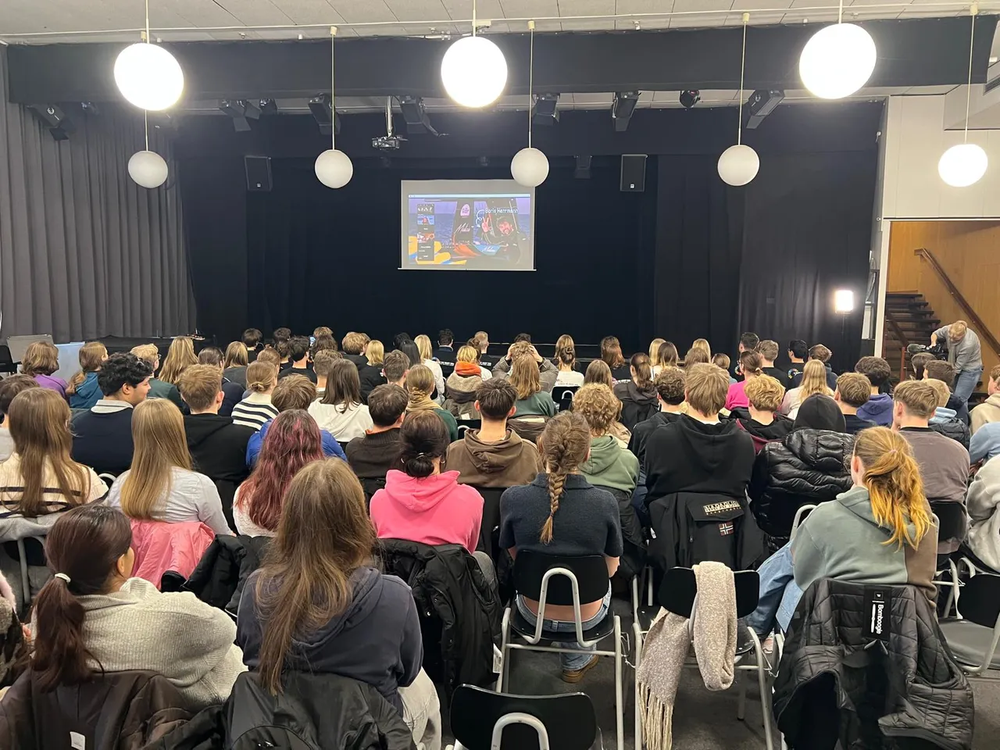
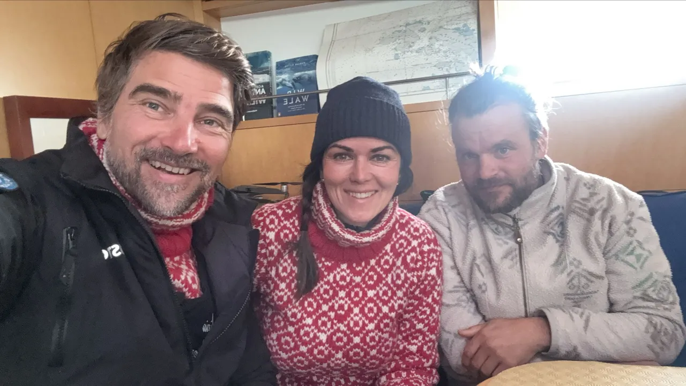

::::::: {.education-opening}
:::::: {.education-opening-copy}
[TOGETHER WITH TEAM MALIZIA’S MY OCEAN CHALLENGE]{.education-eyebrow}

# Bringing Antarctica into the classroom.

What can a penguin tell us about the ocean? How do scientists work among sea ice and storms? And why does Antarctica matter to all of us?

Together with **My Ocean Challenge**, we want to turn questions like these into opportunities to learn. We connect Antarctic field research with the curiosity of young people—through conversations, photographs, and stories from the expedition.

[Discover My Ocean Challenge ↗](https://www.team-malizia.com/news/about-my-ocean-challenge){.education-text-link}
::::::
:::::: {.education-opening-photo}
{fig-alt="Pupils gathered in a school auditorium for a live connection with the expedition."}
::::::
:::::::

::::::: {.education-collaboration}
[ONE OCEAN. SHARED CURIOSITY.]{.education-eyebrow}

## Learning together with My Ocean Challenge

My Ocean Challenge is Team Malizia’s education programme, connecting sailing with ocean and climate learning. Our collaboration builds on that work, bringing Antarctic wildlife, polar research, and first-hand expedition experience into the conversation.

We are developing ways to contribute additional classroom talks, learning materials, and encounters with the people behind the science. We want these activities to complement My Ocean Challenge and give teachers practical ways to explore Antarctic ecosystems with their pupils.
:::::::

::::::: {.education-activities}
## What we are working towards

:::::: {.education-activity-grid}
::::: {.education-activity}
[01]{.education-number}

### Meet the expedition team

Classroom talks and opportunities to ask researchers, sailors, and photographers about their work, wildlife, and life on an Antarctic expedition.
:::::
::::: {.education-activity}
[02]{.education-number}

### Explore the science

Learning materials that connect penguins, food webs, tracking, and environmental change with the questions our team investigates in the field.
:::::
::::: {.education-activity}
[03]{.education-number}

### Follow the discoveries

Photographs and expedition stories that help make remote places tangible and encourage young people to ask their own questions about ocean protection.
:::::
::::::

*Activities and new materials are being developed together. Please contact us to discuss interests and availability.*
:::::::

::::::: {.education-story}
:::::: {.education-story-photo}
{fig-alt="Three members of the expedition team together inside Malizia Explorer."}
::::::
:::::: {.education-story-copy}
[ALREADY CONNECTING CLASSROOMS]{.education-eyebrow}

## Classroom in the ice

During the 2025 Antarctic expedition, around **120 pupils in Kiel** joined the team virtually aboard *Malizia Explorer* for an hour. Scientists, sailors, and photographers answered their questions as the vessel travelled through Antarctic waters towards the Danger Islands.

The exchange brought expedition life into the classroom—and pupils’ curiosity directly to the people doing the research. It is a starting point for the educational work we want to continue together.

[Read the story on Team Malizia ↗](https://www.team-malizia.com/news/classroom-in-the-ice){.education-text-link}
::::::
:::::::

::::::: {.education-contact}
[FOR TEACHERS & EDUCATION PARTNERS]{.education-eyebrow}

## What would your classroom like to discover?

If you are interested in a classroom talk, Antarctic learning materials, or developing an educational activity together, we would be pleased to hear from you.

Tell us your pupils’ age group, the topics you are exploring, and what you have in mind. We can then discuss what might be possible with the team and My Ocean Challenge.

[Start a conversation](contact.qmd){.btn .education-button}
:::::::
