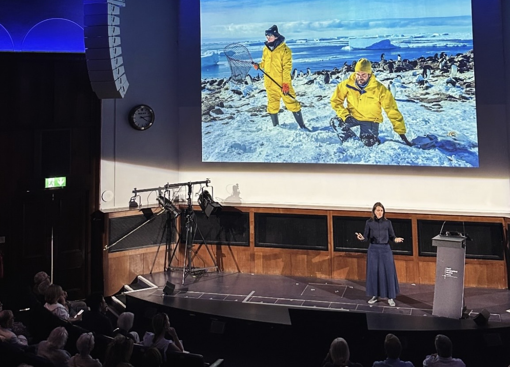

{fig-alt="Esther Horvath on stage at the Royal Geographical Society in London." width=900px}

On **6 August 2026**, polar photographer and National Geographic Explorer **Esther Horvath** spoke at the **Royal Geographical Society in London**, marking the **125th anniversary of the Discovery Expedition**. Her talk included photographs and experiences from the Danger Islands expedition aboard *Malizia Explorer*.

## A different kind of discovery

Polar regions have always been places where knowledge is hard-won. Historic expeditions travelled into largely unknown landscapes. Today, Esther documents a different kind of exploration: the work of scientists investigating how ice, oceans, atmosphere, and ecosystems are changing.

Their discoveries are new insights into a transforming planet. Through her photography, Esther shows how researchers collect data in extreme cold, work through polar darkness, and build the long-term observations that underpin our understanding of climate and environmental change.

Her work brings these experiences beyond the field—making visible both the changes unfolding in the Arctic and Antarctic and the people dedicated to understanding them.

[Explore Esther’s photography ↗](https://www.estherhorvath.com/)

[← All news](news.qmd)
