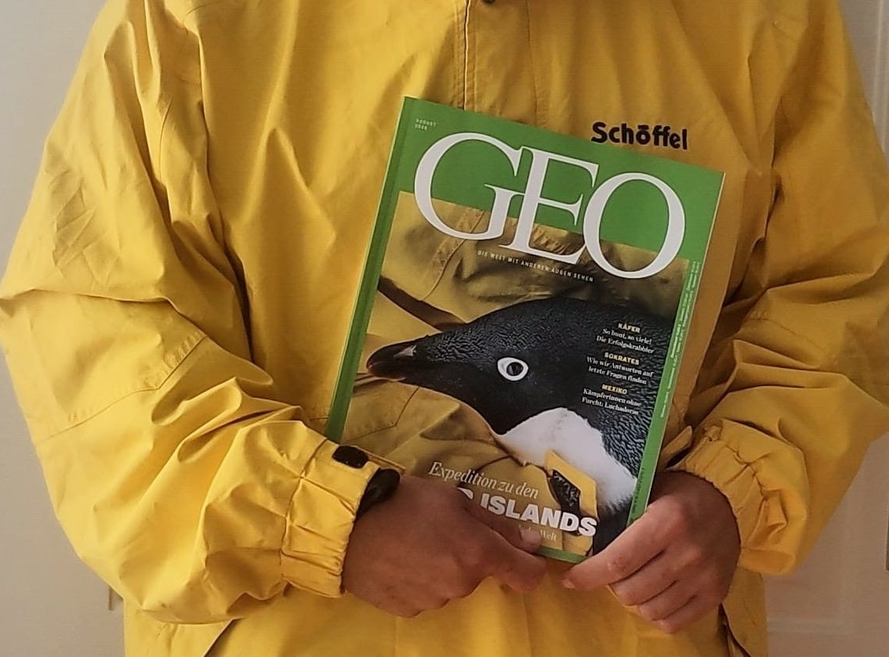

{.news-cover width=380px}

Our expedition to the Danger Islands has made the cover of **GEO**. We are delighted to see Antarctic wildlife and the research behind its protection reaching a wider audience.

The cover story, *Expedition zu Deutschlands weißem Fleck*, offers a chance to discover more about the expedition.

[Read the story at GEO ↗](https://www.geo.de/natur/expedition-zu-deutschlands-weissem-fleck-37974630.html){.btn .news-button}

*Article in German; a subscription may be required.*

[← All news](news.qmd)
