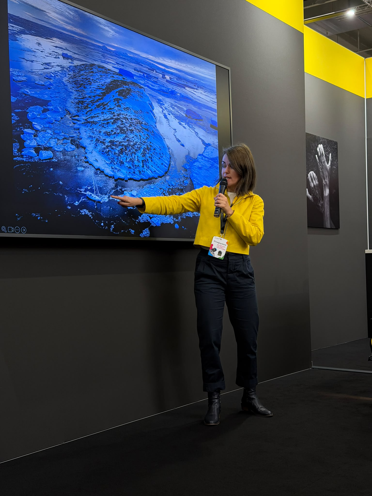
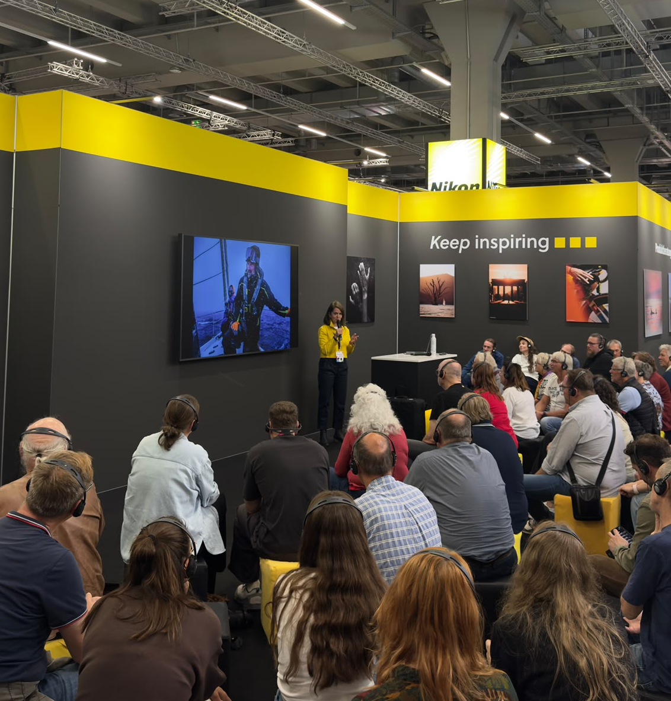

{fig-alt="Photograph accompanying Esther Horvath’s Imaging World presentation." width=900px}

## A journey into the world behind the photographs

In December 2025, **Esther Horvath** joined professional sailor **Boris Herrmann** aboard *Malizia Explorer* for the Danger Islands expedition in Antarctica. The journey became the cover story of **GEO’s August issue**.

In her talks on the main stage and Nikon stage at **Imaging World**, Esther takes audiences behind the scenes of that mission—and into the wider world of polar research.

From the Arctic polar night and expeditions across sea ice to the penguin colonies of the Danger Islands, she shares how scientists work in remote environments and how she documents their research through photography. Alongside the images are the people, challenges, and moments that rarely make it into a finished story.

Her perspective offers a close look at modern polar science and a connection to places whose changes shape our shared future.

{fig-alt="A second photograph accompanying Esther Horvath’s Imaging World presentation." width=900px}

[Visit Esther’s website ↗](https://www.estherhorvath.com/){.team-profile-link}

[← All news](news.qmd)
