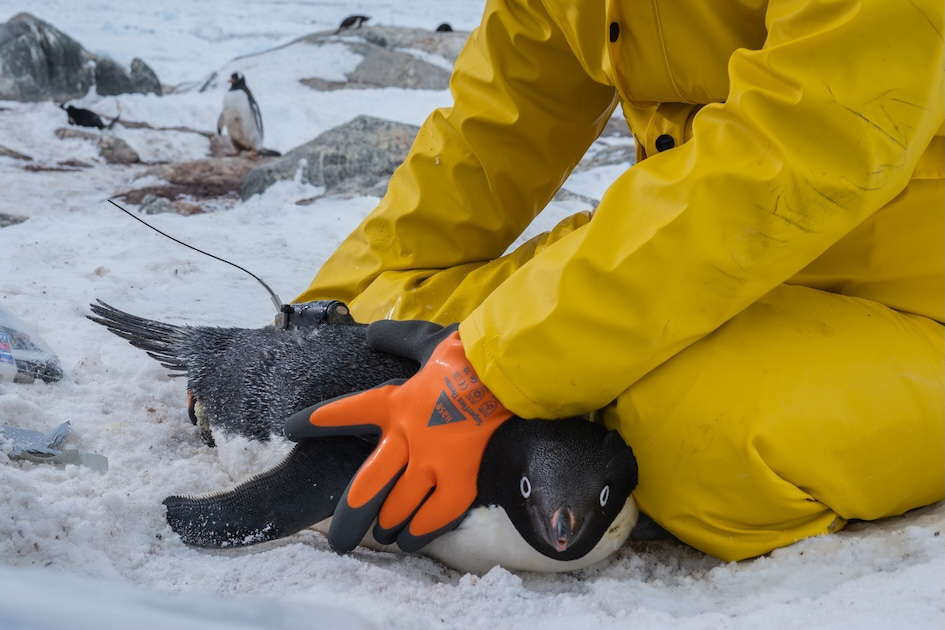

::::::: {.research-intro}
[OUR RESEARCH]{.research-eyebrow}

# Understanding wildlife to guide conservation.

Our research connects the movements, populations, health, and history of Antarctic wildlife with the habitats that sustain it.

[Tracking](#tracking){.research-topic-link} [Population Monitoring](#population-monitoring){.research-topic-link} [Health Surveillance](#health-surveillance){.research-topic-link} [Paleoecology](#paleoecology){.research-topic-link}
:::::::

::::::: {#tracking .research-section}
[01 / TRACKING]{.research-eyebrow}

## Following seabirds beyond the shoreline

:::::: {.research-tracking-grid}
::::: {.research-tracking-copy}
Protecting a breeding colony is only part of the story. Penguins and other seabirds depend on feeding grounds at sea, returning repeatedly to their nests to share incubation duties or feed their chicks.

Small tracking devices reveal where birds travel, how long they spend away, and which waters they use repeatedly. Following these movements across seasons helps us understand how access to food changes with sea ice and other environmental conditions.

Combined with population and environmental observations, movement data can identify important feeding areas and the times when birds depend on them most. This evidence can guide the design of **marine protected areas** and targeted seasonal measures that reduce additional human pressures around breeding colonies.

[Effective conservation needs to connect the places where seabirds breed with the waters where they feed.]{.research-key-message}
:::::
::::: {.research-tracking-photo}
{fig-alt="A researcher in protective field clothing fitting a tracking device to an Adélie penguin."}
:::::
::::::

::::::: {.research-coming-grid}
:::::: {#population-monitoring .research-coming}
[02]{.research-eyebrow}

## Population Monitoring

More about this research theme is coming soon.
::::::
:::::: {#health-surveillance .research-coming}
[03]{.research-eyebrow}

## Health Surveillance

More about this research theme is coming soon.
::::::
:::::: {#paleoecology .research-coming}
[04]{.research-eyebrow}

## Paleoecology

More about this research theme is coming soon.
::::::
:::::::
