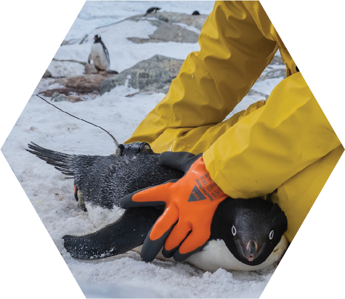
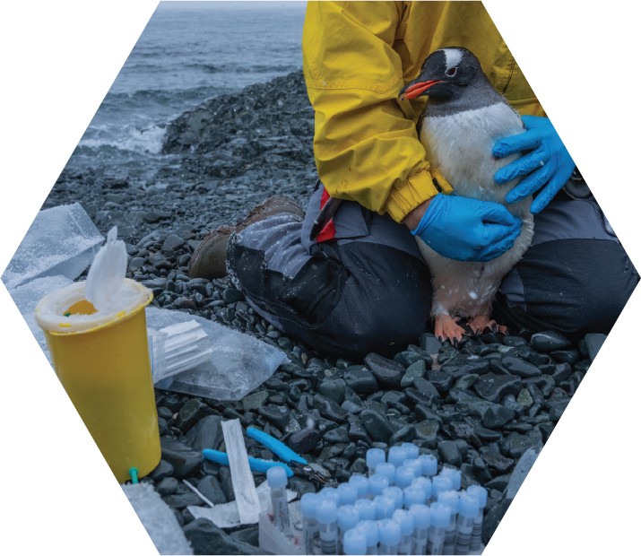
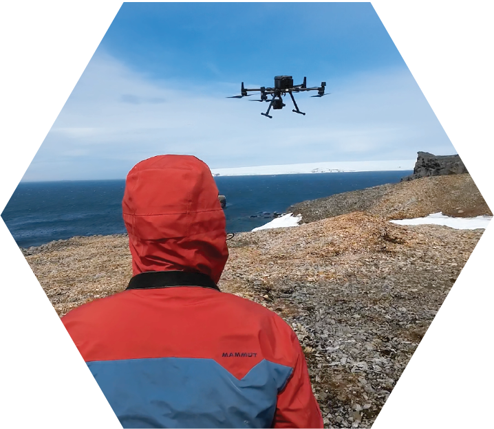
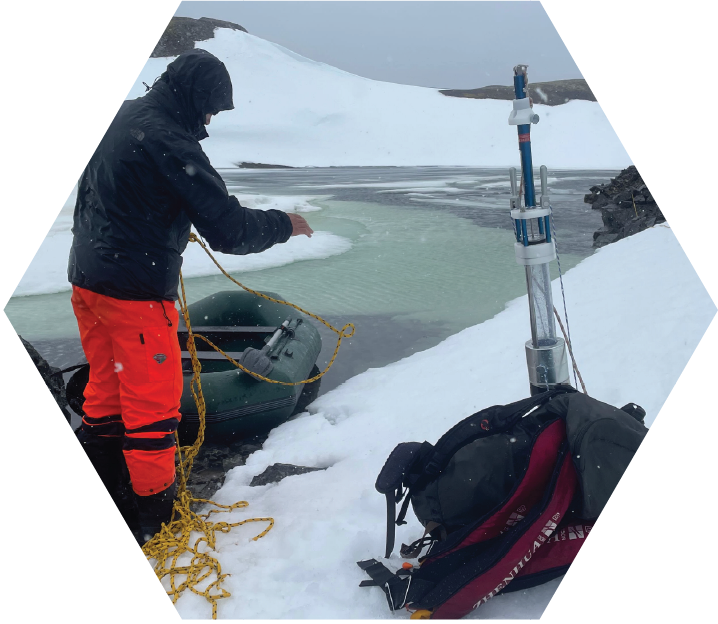

::::::: {.research-intro}
[OUR RESEARCH]{.research-eyebrow}

# Understanding wildlife to guide conservation

Our research connects the movements, populations, health, and history of Antarctic wildlife with the habitats that sustain it.

[Tracking](#tracking){.research-topic-link} [Health Surveillance](#health-surveillance){.research-topic-link} [Population Monitoring](#population-monitoring){.research-topic-link} [Paleoecology](#paleoecology){.research-topic-link}
:::::::

::::::: {#tracking .research-section}
[01 / TRACKING]{.research-eyebrow}

## Following seabirds beyond the shoreline

:::::: {.research-tracking-grid}
::::: {.research-tracking-copy}
Protecting a breeding colony is only part of the story. Penguins and other seabirds depend on feeding grounds at sea, returning repeatedly to their nests to share incubation duties or feed their chicks.

Small tracking devices reveal where birds travel, how long they spend away, and which waters they use repeatedly. Following these movements across seasons helps us understand how access to food changes with sea ice and other environmental conditions.

Combined with population and environmental observations, movement data can identify important feeding areas and the times when birds depend on them most. This evidence can guide the design of **marine protected areas** and targeted seasonal measures that reduce additional human pressures around breeding colonies.

[Effective conservation needs to connect the places where seabirds breed with the waters where they feed.]{.research-key-message}
:::::
::::: {.research-tracking-photo}

:::::
::::::
:::::::

::::::: {#health-surveillance .research-section}
[02 / HEALTH SURVEILLANCE]{.research-eyebrow}

## Understanding the health of Antarctic ecosystems

:::::: {.research-tracking-grid}
::::: {.research-tracking-copy}
Protecting a breeding colony is only part of the story. Penguins and other seabirds depend on feeding grounds at sea, returning repeatedly to their nests to share incubation duties or feed their chicks.

Small tracking devices reveal where birds travel, how long they spend away, and which waters they use repeatedly. Following these movements across seasons helps us understand how access to food changes with sea ice and other environmental conditions.

Combined with population and environmental observations, movement data can identify important feeding areas and the times when birds depend on them most. This evidence can guide the design of **marine protected areas** and targeted seasonal measures that reduce additional human pressures around breeding colonies.

[By measuring human pressures on ecosystem health, we aim to guide targeted action that reduces harm and strengthens the protection of Antarctic wildlife.]{.research-key-message}
:::::
::::: {.research-tracking-photo}

:::::
::::::
:::::::

::::::: {#population-monitoring .research-section}
[03 / POPULATION MONITORING]{.research-eyebrow}

## Following populations through change

:::::: {.research-tracking-grid}
::::: {.research-tracking-copy}
We use drones and camera traps to estimate seabird population sizes, count breeding pairs, and monitor when birds breed and how successfully they raise their chicks. Repeated observations reveal changes across seasons and years.

Together, these records help us understand how seabird populations respond to rapid environmental change and direct human pressures—and distinguish short-term fluctuations from longer-term trends.

[By tracking changes in population size and breeding performance, we aim to detect warning signs early and guide conservation measures where they are most needed.]{.research-key-message}
:::::
::::: {.research-tracking-photo}

:::::
::::::
:::::::

::::::: {#paleoecology .research-section}
[04 / PALEOECOLOGY]{.research-eyebrow}

## Reading the history of Antarctic ecosystems

:::::: {.research-tracking-grid}
::::: {.research-tracking-copy}
We collect sediment cores from lakes and sheltered bays to investigate how Antarctic ecosystems have changed over time. As sediments accumulate, they preserve traces of DNA from organisms that lived in and around these environments.

By analysing this sedimentary DNA, we reconstruct past biodiversity patterns and explore how ecological communities responded to changing conditions. These records extend our perspective beyond modern observations, revealing changes over centuries to millennia.

[Understanding the past helps us place today’s changes in context and build a stronger foundation for protecting Antarctic ecosystems in the future.]{.research-key-message}
:::::
::::: {.research-tracking-photo}

:::::
::::::
:::::::