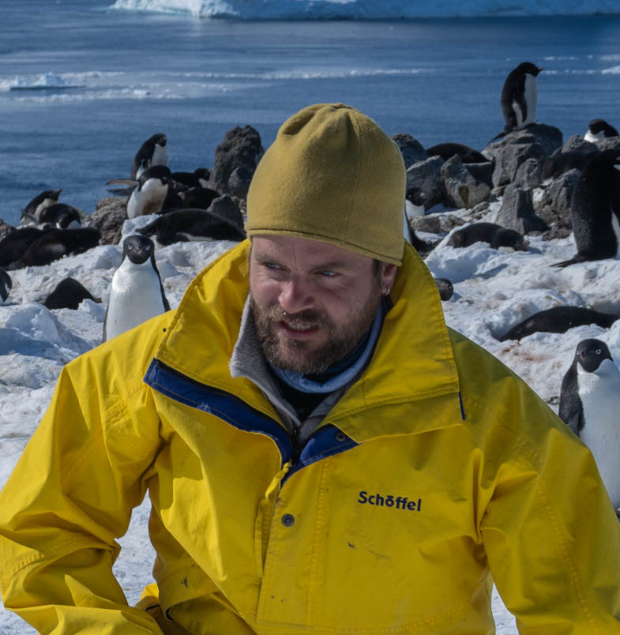
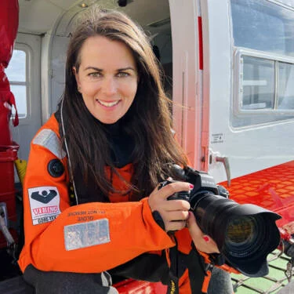
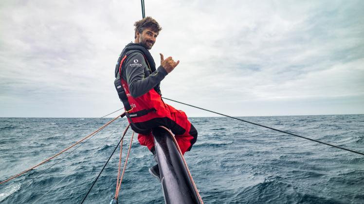

::: team-intro
We bring together polar research, offshore sailing, and photography to understand Antarctic ecosystems and inspire their protection.
:::

:::::::::::: team-profiles
::::: team-profile
::: team-portrait
{.team-photo}
:::

::: team-bio
## Simeon Lisovski

[Scientific Lead · Polar Ecology & Conservation]{.team-role}

Simeon is a researcher at the Alfred Wegener Institute and the Leibnitz Insitute for Zoo and Wildlife Research specialising in polar biology and seabird ecology. He studies how environmental change affects wildlife, animal movements, and ecosystem health, with Antarctic fieldwork on Adélie penguins, skuas, and southern giant petrels. His research also examines how pathogens reach Antarctica and how avian influenza circulates among seabirds. For Antarctic Wildlife Protection, he leads the scientific programme, linking seabird tracking and colony monitoring to habitat conservation.

[Meet Simeon at AWI ↗](https://www.awi.de/ueber-uns/organisation/mitarbeiter/detailseite/simeon-lisovski.html){.team-profile-link}
:::
:::::

::::: team-profile
::: team-portrait
{.team-photo}
:::

::: team-bio
## Esther Horvath

[Photography & Science Communication]{.team-role}

Esther is a documentary and science photographer whose work brings polar research and the people behind it into public view. Since 2015, she has documented scientific expeditions in the polar regions, including the MOSAiC expedition. Her photography received a World Press Photo award in 2020. Through photographs and stories, she connects audiences with Antarctic wildlife, the realities of field research, and the importance of protecting these environments.

[Esther’s World Press Photo profile ↗](https://www.worldpressphoto.org/esther-horvath-bio){.team-profile-link}
:::
:::::

::::: team-profile
::: team-portrait
{.team-photo} [Boris Herrmann]{.team-portrait-caption}
:::

::: team-bio
## Team Malizia

[Research Platform, Outreach & Ocean Education]{.team-role}

Boris Herrmann and his *Team Malizia* connects offshore sailing with ocean science, education, and climate action. The team contributes the research sailing vessel *Malizia Explorer*, alongside its communication and education activities. Its *My Ocean Challenge* programme brings ocean and climate science to young people—including live connections between classrooms and Antarctic expeditions. Together, these contributions help researchers reach remote habitats and bring the expedition’s discoveries to audiences beyond the scientific community.

[Discover Malizia Explorer ↗](https://www.malizia-explorer.com/){.team-profile-link}
:::
:::::
::::::::::::
