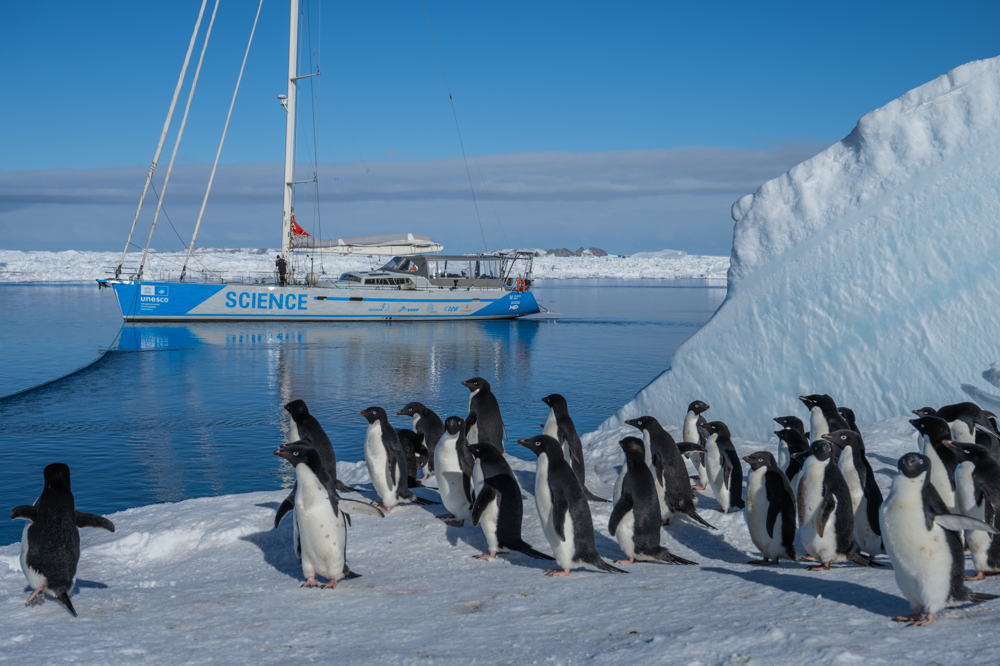
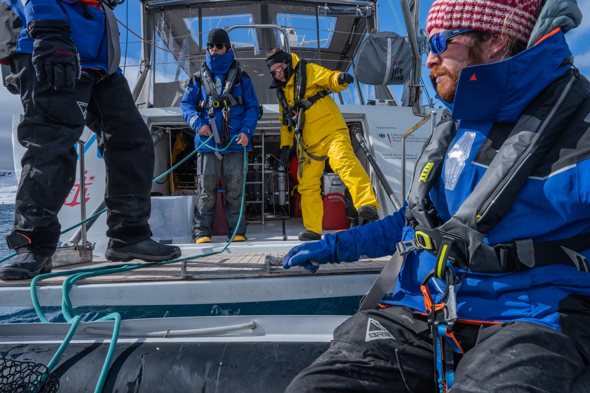
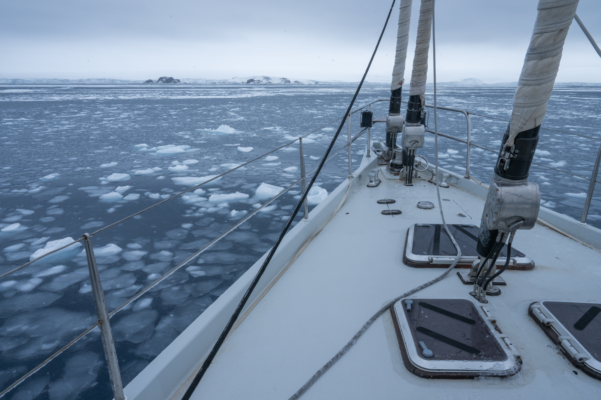

::::::: {.vessel-opening}
:::::: {.vessel-opening-copy}
[THE VESSEL]{.vessel-eyebrow}

# Malizia Explorer

[A sailing platform for science.]{.vessel-lead}

From the ship to the shore, our Antarctic work brings together researchers, sailors, and photographers. *Malizia Explorer* is where these parts of the expedition meet.

Team Malizia’s aluminium research sailing vessel offers a base for small scientific teams working in remote waters. Sailing capability, a variable draft, equipment-handling facilities, and satellite communications support a range of research missions.
::::::
:::::: {.vessel-opening-photo}
{fig-alt="Malizia Explorer anchored beside Antarctic ice, with Adélie penguins in the foreground."}
::::::
:::::::

::::::: {.vessel-facts aria-label="Vessel specifications"}
:::::: {.vessel-fact}
[26.3 m]{.vessel-fact-value}

Length
::::::
:::::: {.vessel-fact}
[7 m]{.vessel-fact-value}

Beam
::::::
:::::: {.vessel-fact}
[2.5–4.2 m]{.vessel-fact-value}

Draft
::::::
:::::: {.vessel-fact}
[Up to 9]{.vessel-fact-value}

Scientists / project personnel
::::::
:::::::

::::::: {.vessel-working}
:::::: {.vessel-working-photo}
{fig-alt="Expedition members handling ropes and transferring between the vessel and a small boat."}
::::::
:::::: {.vessel-working-copy}
[FROM DECK TO FIELDWORK]{.vessel-eyebrow}

## A shared base for discovery

For our project, the vessel connects the journey with the work on land: planning observations, preparing equipment, reviewing findings, and sharing expedition stories.

Its role extends beyond transport. Time aboard brings different kinds of expertise together, linking the practical demands of sailing with the questions that guide the research.

The official vessel specifications list up to four professional crew and a maximum of 14 people aboard. Team composition and operations depend on the mission.
::::::
:::::::

::::::: {.vessel-science}
[SCIENCE ON BOARD]{.vessel-eyebrow}

## Observing the ocean around us

The vessel’s research equipment adds environmental observations to the expedition’s view of Antarctic wildlife.

:::::: {.vessel-science-grid}
::::: {.vessel-science-item}
### Water-column measurements

A CTD rosette collects water samples and measures conditions below the surface; the current deployment system reaches 480 metres.
:::::
::::: {.vessel-science-item}
### Measurements underway

OceanPack records surface-water carbon dioxide, oxygen, salinity, and temperature while the vessel travels.
:::::
::::: {.vessel-science-item}
### Flexible research support

Plankton sampling and imaging, weather observations, small boats, and mission-specific instruments support complementary research activities.
:::::
::::::

Equipment and deployment options are agreed with the vessel team for each mission.
:::::::

::::::: {.vessel-plan-section}
[TAKE A LOOK INSIDE]{.vessel-eyebrow}

## Life and work aboard

The plan below shows the arrangement of accommodation and shared spaces. On an expedition, these spaces become a place to prepare, exchange ideas, and return to after fieldwork.

::: {.vessel-plan}
[{fig-alt="Interior plan of Malizia Explorer showing berths, central shared spaces and toilet and shower compartments."}](images/MaliziaExplorerPlan.png)
:::

[Open the vessel plan at full size ↗](images/MaliziaExplorerPlan.png){.vessel-text-link}
:::::::

::::::: {.vessel-final-photo}
{fig-alt="View over the bow of Malizia Explorer towards scattered sea ice and distant Antarctic islands."}
:::::::

::::::: {.vessel-discover}
[EXPLORE THE PLATFORM]{.vessel-eyebrow}

## Meet Malizia Explorer

Find further specifications, instrumentation details, and opportunities for scientific collaboration on the vessel’s official website.

[Visit the Malizia Explorer website ↗](https://www.malizia-explorer.com/our-sailing-platform-for-science){.btn .vessel-button}
:::::::

::: {.vessel-source}
Vessel specifications and equipment information: [Malizia Explorer’s official science platform page](https://www.malizia-explorer.com/our-sailing-platform-for-science). Equipment and availability may change.
:::
