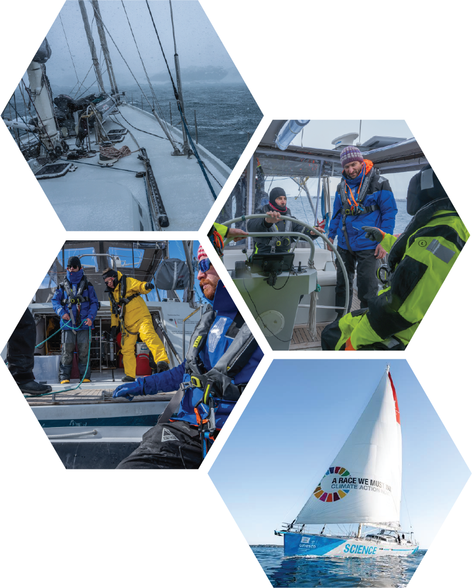
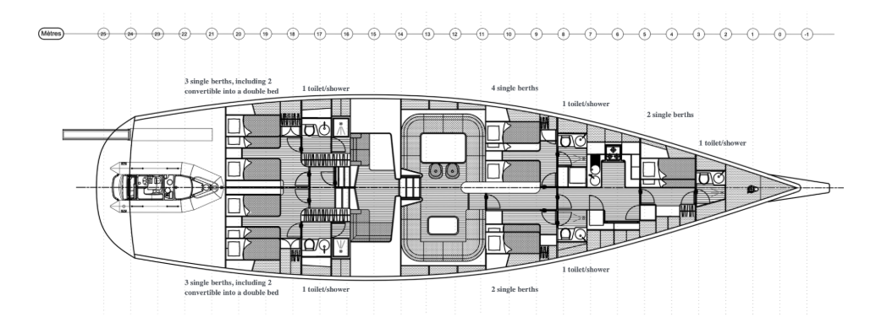

::::::: {.vessel-opening}
:::::: {.vessel-opening-copy}
[THE VESSEL]{.vessel-eyebrow}

# Malizia Explorer

[A sailing platform for science.]{.vessel-lead}

From the ship to the shore, our Antarctic work brings together researchers, sailors, and photographers. *Malizia Explorer* is where these parts of the expedition meet.

Team Malizia’s aluminium research sailing vessel offers a base for small scientific teams working in remote waters. Sailing capability, a variable draft, equipment-handling facilities, and satellite communications support a range of research missions.
::::::
:::::: {.vessel-opening-photo}
{fig-alt="Malizia Explorer anchored beside Antarctic ice, with Adélie penguins in the foreground."}
::::::
:::::::

::::::: {.vessel-facts aria-label="Vessel specifications"}
:::::: {.vessel-fact}
[26.3 m]{.vessel-fact-value}

Length
::::::
:::::: {.vessel-fact}
[7 m]{.vessel-fact-value}

Beam
::::::
:::::: {.vessel-fact}
[2.5–4.2 m]{.vessel-fact-value}

Draft
::::::
:::::: {.vessel-fact}
[Up to 10]{.vessel-fact-value}

Scientists / project personnel
::::::
:::::::

::: {.vessel-plan}

:::

::::::: {.vessel-final-photo}
:::::::

::::::: {.vessel-discover}
[EXPLORE THE PLATFORM]{.vessel-eyebrow}

## Meet Malizia Explorer

Find further specifications, instrumentation details, and opportunities for scientific collaboration on the vessel’s official website.

[Visit the Malizia Explorer website ↗](https://www.malizia-explorer.com/){.btn .vessel-button}
:::::::
