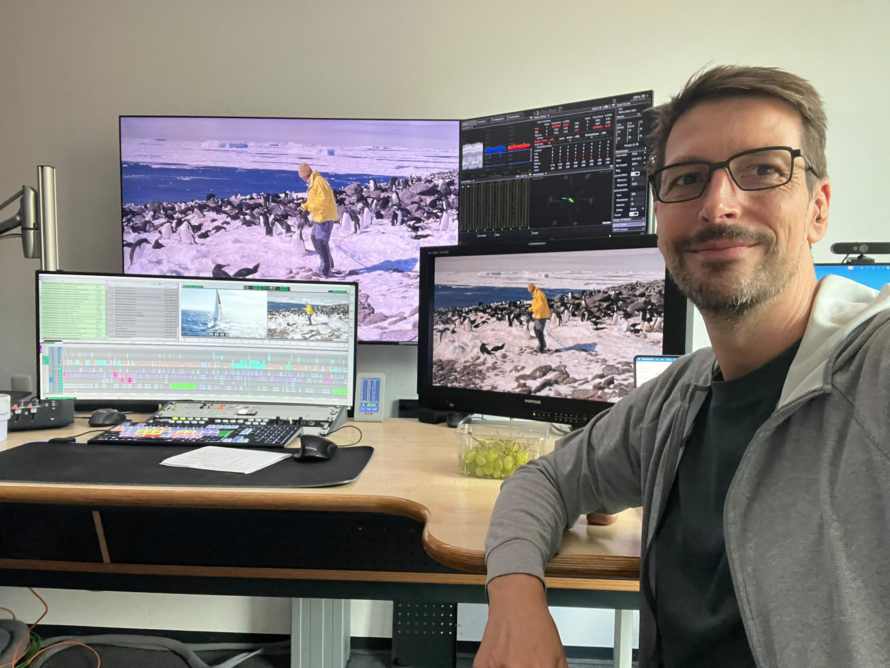

{width=780px}

From the Drake Passage to the penguin colonies of the Danger Islands, a new ZDF documentary brings our Antarctic expedition to the screen.

In *Mission Pinguin – Mit dem Segelboot in die Antarktis*, reporter **Carsten Behrendt** follows the scientists and sailors aboard *Malizia Explorer*, with Boris Herrmann. The approximately 43-minute film offers an insight into Antarctic field research, wildlife, and the challenges of reaching these remote islands.

## When to watch

- **Streaming:** from Sunday, **1 November 2026 at 10:00** on ZDF’s streaming platform.
- **Television:** Sunday, **8 November 2026 at 16:15** on ZDF.

*Times are German local time (CET). The documentary is in German.*

[Documentary details and broadcast information ↗](https://presseportal.zdf.de/pressemappe/mission-pinguin-mit-dem-segelboot-in-die-antarktis){.btn .news-button}

[← All news](news.qmd)
