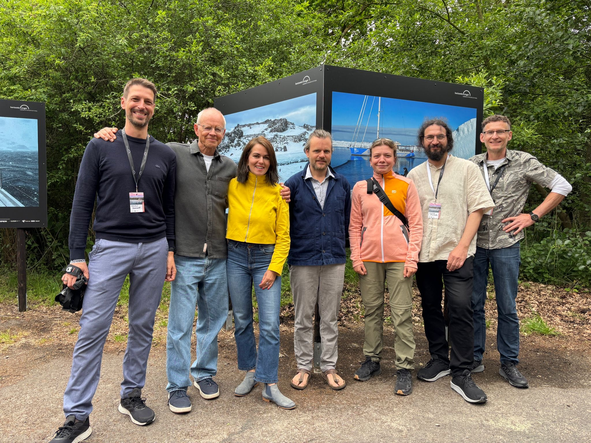

{fig-alt="Photograph accompanying the Danger Islands exhibition in Zingst." width=900px}

**Esther Horvath’s exhibition *Danger Islands*** brings Antarctic field research to Germany’s Baltic coast. Opened on **29 May 2026** as part of the **horizonte zingst environmental photography festival**, it is on view at **Schlösschen Sundische Wiese in Zingst until 7 November 2026**.

In December 2025, Esther joined Boris Herrmann aboard *Malizia Explorer* to document a scientific expedition to the Danger Islands. The remote archipelago is home to an immense population of breeding Adélie penguins. Thick pack ice and harsh weather made access difficult; ultimately, the team had just **12 hours on land** to carry out its work.

Through her photographs, Esther offers a rare view of the people and research behind the expedition—and the challenges of working in one of Antarctica’s least accessible places.

## A conversation beyond the photographs

On **31 May 2026**, a **Horizonte Talk at the Multimediahalle Zingst** brought scientists from the expedition team together for a panel discussion. They shared insights into their research, the realities of Antarctic fieldwork, and why these findings matter for understanding a changing planet.

## Visit the exhibition

- **Exhibition:** *Danger Islands* by Esther Horvath
- **Location:** Schlösschen Sundische Wiese, Zingst, Germany
- **Dates:** 29 May–7 November 2026

[Explore Esther’s photography ↗](https://www.estherhorvath.com/)

[← All news](news.qmd)
